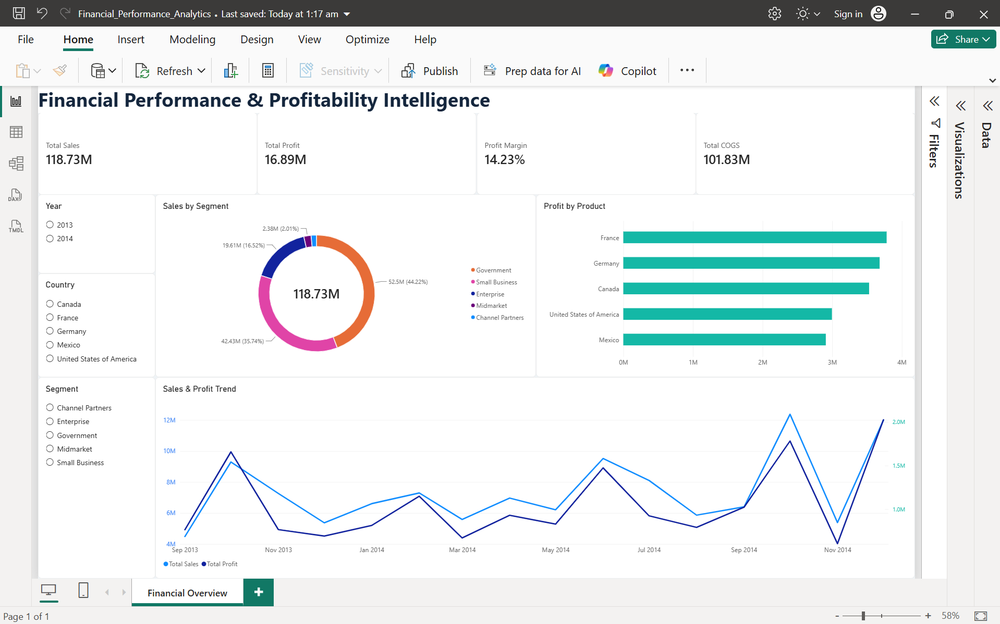

# Financial Performance & Profitability Intelligence

An interactive financial analytics dashboard built with **Microsoft Power BI**, using DAX and Power Query to explore sales performance, profitability, and business-segment trends.

## Dashboard Preview

## Project Overview

The purpose of this project is to transform financial sample data into an interactive dashboard that helps users explore business performance across products, countries, customer segments, and time.

## Key Performance Indicators

- **Total Sales:** 118.73M
- **Total Profit:** 16.89M
- **Profit Margin:** 14.23%
- **Total COGS:** 101.83M

*These values represent the current unfiltered dashboard totals. Currency formatting and units should be interpreted according to the source dataset.*

## Dashboard Features

- Executive KPI cards for sales, profit, profit margin, and cost of goods sold.
- Sales distribution by business segment.
- Product-level profitability comparison.
- Monthly sales and profit trend analysis.
- Interactive slicers for year, country, and segment.

## Tools & Technologies

- Microsoft Power BI
- DAX (Data Analysis Expressions)
- Power Query
- Microsoft Excel

## Skills Demonstrated

- KPI development and financial metric analysis
- Data transformation and preparation
- Interactive dashboard design
- Business data visualization
- Analytical storytelling

## Dataset

This project uses Microsoft's Financial Sample dataset. Refer to the original dataset source and its applicable terms before redistributing the data.

## Limitations

This dashboard focuses on historical sales and profitability analysis. It does not include budget-versus-actual analysis, forecasting, or a complete financial statement model.

## Project File

Open `Financial_Performance_Analytics.pbix` in Power BI Desktop to explore the report.

## Author

Dnyaneshwar G. Lahane

Aspiring Data Scientist | Data Analytics | Business Intelligence
